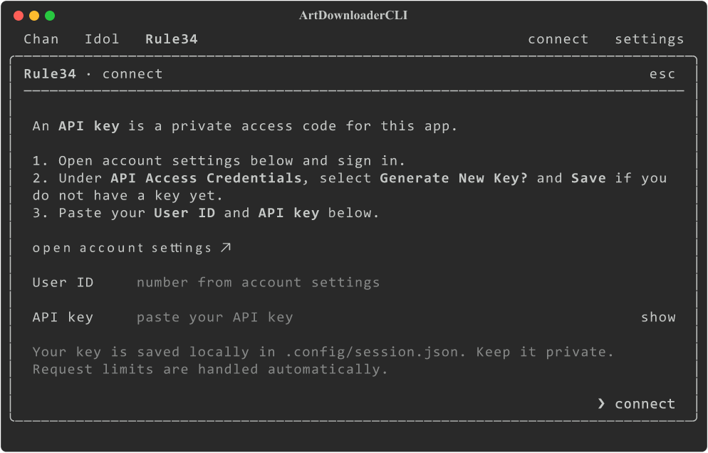
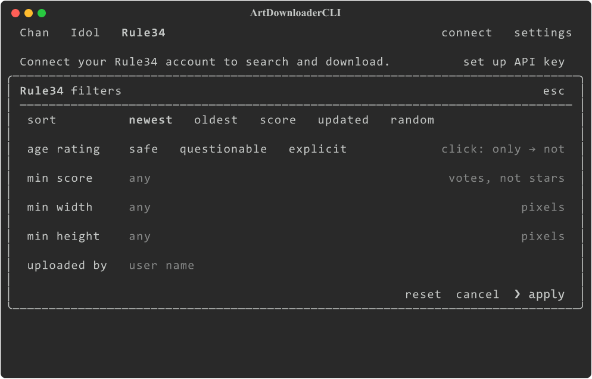

# ArtDownloaderCLI

A terminal app for searching and downloading art from **Sankaku Chan**, **Sankaku Idol** and **Rule34**. Every image can be saved with its tags as captions for a dataset.

Chan and Idol work anonymously. With a Sankaku account you can also:
- Download your likes
- Access media unavailable without authentication or a premium account
- Go past page 50 of a search, if your account has a paid Sankaku subscription

> **About the 50-page limit:** Sankaku itself stops every search after 50 pages unless the account has a paid subscription. This limit comes from Sankaku's servers, not from this app — the app downloads as far as Sankaku lets your account go.

**Rule34 requires a User ID and API key.** The application includes a short setup guide and opens the account settings page for you. See [Connecting Rule34](#connecting-rule34).

## Features
- **Independent sources** – Each site has its own tab, account, settings and download folder; several sites can download at the same time
- **Connection guide** – Optional password sign-in for Sankaku; guided API-key setup for Rule34. Passwords are never saved
- **Source-specific filters** – Each tab exposes the filters supported by its API; see the table below
- **Tag saving** – `.txt` captions and/or `.json` metadata, with tag categories when the source provides them
- **Resume** – Files you already have are skipped, so an interrupted search can be continued
- **Parallel Downloads** – Up to 4 files at once, with adjustable pauses between requests (in **settings**)
- **Terminal title** – ArtDownloaderCLI with an ASCII animation while downloading, plus the state of active and background tabs. The previous title is restored on supported terminals

| Filter | Chan / Idol | Rule34 |
| --- | --- | --- |
| Sort | Newest, popular, quality, random, recently liked/voted | Newest, oldest, score, updated, random |
| Content rating | G, R15+, R18+; include or exclude | Safe, questionable, explicit; include or exclude |
| Minimum rating | Stars | Vote score |
| Dimensions | Resolution presets | Minimum width and height in pixels |
| Date, file type, video duration | Available | Not exposed as controls |
| User filters | Liked, uploaded, voted by; my likes | Uploaded by |

Search tags are passed through to the selected site. Unsupported structured filters
are hidden rather than translated into another site's syntax.

## Preview




# Usage

## Download
Get the latest build from [Releases](https://github.com/VeyDlin/SankakuParser/releases/latest) — no Python needed:
- **Windows** – `ArtDownloaderCLI-<version>-windows.exe`, just run it
- **Linux** – `ArtDownloaderCLI-<version>-linux.tar.gz`, unpack and run `./ArtDownloaderCLI`
- **macOS** – `ArtDownloaderCLI-<version>-macos-arm64.zip` (Apple Silicon) or `-macos-x64.zip` (Intel), unpack and double-click `ArtDownloaderCLI` (it opens in Terminal). The build is not signed, so macOS blocks it at first; allow it with `xattr -d com.apple.quarantine ArtDownloaderCLI` or in System Settings → Privacy & Security → Open Anyway

Downloads and settings are kept next to the executable.
Older releases may still use the name SankakuParser. Existing `.config/` and
`data/` folders remain compatible; keep them next to the new executable.

## Running from source
Requires Python 3.10+.

Run `start.bat` — it is a polyglot script: double-click it on Windows, or run `./start.bat` on Linux and macOS. The first run creates a virtual environment and installs the dependencies, which may take some time.

## Getting started
1. Pick **Chan**, **Idol** or **Rule34**. Each tab checks its saved connection on start
2. For Sankaku, click **sign in** or browse anonymously. For Rule34, click **set up API key**
3. Enter a search query (matching tags drop down as you type), optionally set **filters**, and press **▶ start**
4. Enjoy your downloads!

Each search goes to its own folder under `data/chan/`, `data/idol/` or `data/rule34/`
by default, named after the search unless you type another name in **folder**.
**limit** caps the number of new media files; leave it empty to download everything
the source makes available. **split by format** sorts files into subfolders by
extension, and **tags** picks the tag files to write.

## Connecting Rule34

An **API key** is a private access code that lets an application use your account.
It is different from your password.

1. In the Rule34 tab, click **set up API key**.
2. Click **open account settings**, then sign in in your browser. Complete a browser
   verification if the site requests one.
3. Find **API Access Credentials**. If you do not have a key, select **Generate New
   Key?**, click **Save**, and return to that section.
4. Copy **User ID** and **API key** into the application's fields, then click
   **connect**. The application checks the key before saving it.

Credentials are stored locally in `.config/session.json`, separately from settings.
Do not share that file. **disconnect** removes the saved key and remembers only
the User ID. A temporary connection error keeps the key and offers **retry check**.

Rule34 API requests are paced automatically across all workers. On a rate-limit
response, the app waits according to the server's `Retry-After` value when possible
and retries a limited number of times. This does not guarantee unlimited access.
The API documents up to 1000 posts per request and reserves the right to change
limits. See [Rule34 API documentation](https://api.rule34.xxx/).

A tab that is working in the background shows its state in its title: `↓` downloading, `‖` paused.

## Controls

The controls behave like a player: `▶ start` when idle; once running it turns into `‖ pause` and `■ stop`, and a paused download offers `▶ resume`.

- **Mouse** – click anything; scroll the download list with the wheel
- **Keyboard** – arrows or `Tab` move between controls, `Enter` or `Space` presses a button or flips a checkbox, `Esc` closes a dialog, `Ctrl+Q` quits
- **Suggestions** – while a list is open under a field, `↑`/`↓` pick an entry, `Tab`/`Enter` take it, `Esc` closes the list

Pause takes effect between files. Stop interrupts queued API waits and cancels
streaming transfers at the next received chunk; a network request already waiting
for a response is bounded by its timeout. Files are written to temporary paths
and moved into place only after completion, so a failed transfer does not leave a
partial file under the final filename.

Scrolling up in the download list stops it from following new files; a **↓ scroll to bottom** button then counts the new ones and jumps back down.

## Sankaku search limits

Sankaku rations "advanced" filters: **without signing in, a search may use at most 2** of date, file type, duration, size, age rating and the user filters (sort, star rating, plain tags and "G only" are free). The filters dialog counts them as you go. Searching by who *liked* posts usually times out on Sankaku's side without signing in, and a user who keeps likes or votes private cannot be searched by them.

Posts that need an account are listed as `sign-in needed` instead of being downloaded.

## Development

```sh
python -m pip install -r requirements-dev.txt
python -m unittest discover -s tests
python -m mypy ArtDownloader main.py
```

Tests use temporary settings and simulated HTTP responses; they do not read your
saved credentials or download live content. Authenticated API access still needs
verification with your own key.

The [project tree](docs/project-structure.md) describes the modules.
The [source design](docs/rule34-design.md) records the source contract, connection
flow and standalone terminal-title module.
