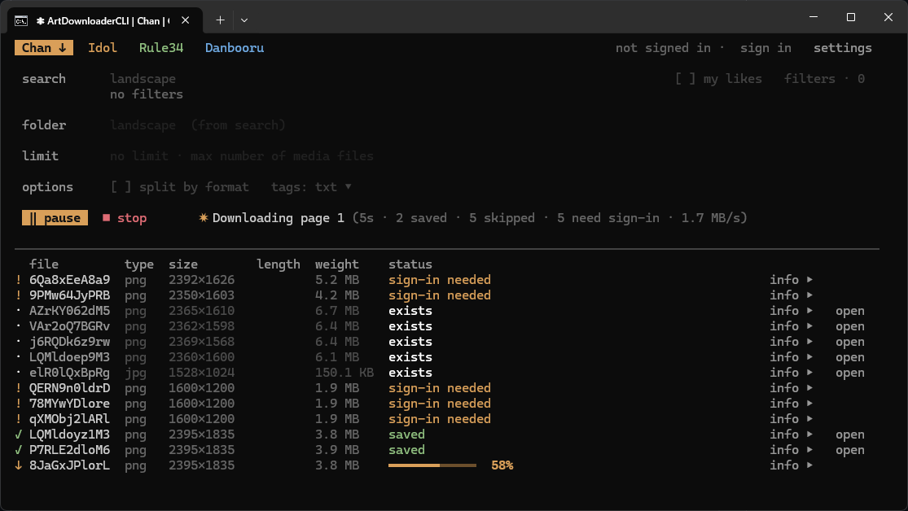
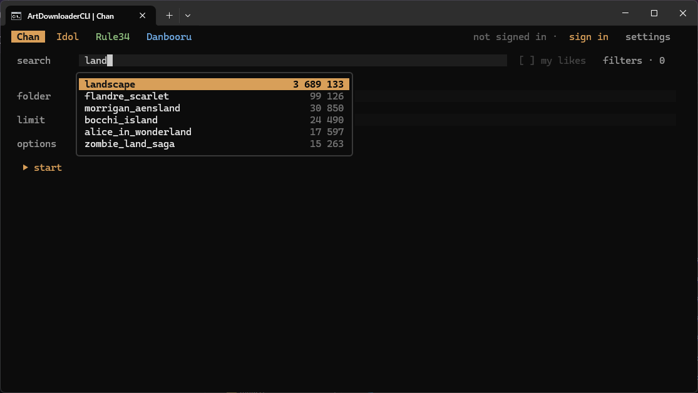
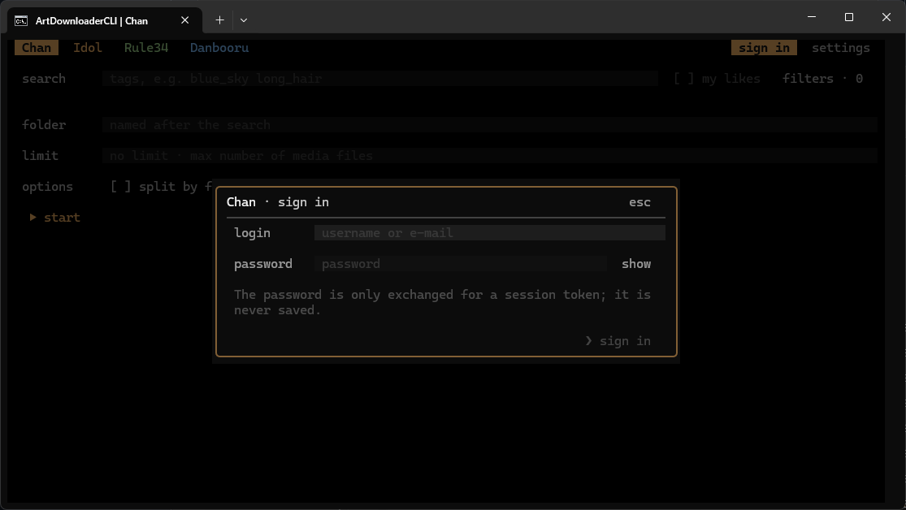
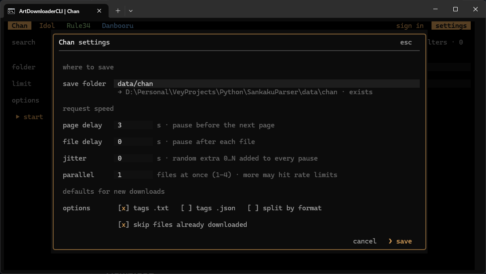

# ArtDownloaderCLI

A terminal app for searching and downloading art from **Sankaku Chan**, **Sankaku Idol**, **Rule34** and **Danbooru**. Save images together with their tags to build datasets for training AI models.

Sankaku Chan and Idol work anonymously. With a Sankaku account you can also:

- Download your likes
- Access media unavailable without authentication or a premium account
- Go past page 50 of a search, if your account has a paid Sankaku subscription

> **About the 50-page limit:** Sankaku itself stops every search after 50 pages unless the account has a paid subscription. This limit comes from Sankaku's servers, not from this app — the app downloads as far as Sankaku lets your account go.

## Features

- **Four sources** — Search and download from several sites at the same time
- **Search filters** — Find posts by content rating, date, size, file type, score and more, depending on the site
- **Favorites** — Download your favorites from Sankaku and Danbooru
- **Tag saving** — Save tags beside each file as `.txt` captions or `.json` metadata grouped by category, when the site provides it
- **Resume** — Skip files you already have when continuing an interrupted download
- **Parallel downloads** — Download up to four files at once, with adjustable pauses between requests in **settings**

## Preview

## Download

Get the latest build from [Releases](https://github.com/VeyDlin/SankakuParser/releases/latest) — no Python needed.

- **Windows** — Download `ArtDownloaderCLI-<version>-windows.exe` and run it.
- **Linux** — Unpack `ArtDownloaderCLI-<version>-linux.tar.gz` and run `./ArtDownloaderCLI`.
- **macOS** — Unpack `ArtDownloaderCLI-<version>-macos-arm64.zip` for Apple Silicon or `-macos-x64.zip` for Intel, then open `ArtDownloaderCLI`. If macOS blocks the unsigned app, allow it in **System Settings → Privacy & Security → Open Anyway**, or run `xattr -d com.apple.quarantine ArtDownloaderCLI`.

Downloads and settings are kept next to the executable. When updating from SankakuParser, keep your existing `.config/` and `data/` folders beside the new app.

## Getting started

1. Choose **Chan**, **Idol**, **Rule34** or **Danbooru**.
2. Sign in if needed using the instructions in the app.
3. Enter search tags, adjust **filters** if needed, and press **▶ start**.

Each search goes to its own folder under the site's save folder (`data/chan/`, `data/idol/`, `data/rule34/` or `data/danbooru/` by default), named after the search unless you type another name in **folder**. **limit** caps the number of new media files; leave it empty to download everything the site makes available. **split by format** sorts files into subfolders by extension, and **tags** picks the tag files to write.

Use **my likes** in the filters to download your favorites from Sankaku or Danbooru after signing in.

## Accounts and limits

| Site | Sign-in |
| --- | --- |
| Sankaku Chan / Idol | Optional; use your username and password |
| Rule34 | Required; the app guides you through copying your access key |
| Danbooru | Optional; use your username and access key |

An access key lets the app connect to your account without your website password. The sign-in forms include links and step-by-step instructions.

Passwords are never saved, and you stay signed in between runs.

Some posts require an account or a paid subscription. Signing in gives the app the access your account already has; it does not remove site restrictions.

### Search limits

Sankaku rations "advanced" filters: **without signing in, a search may use at most 2** of date, file type, duration, size, age rating and the user filters (sort, star rating, plain tags and "G only" are free). The filters dialog counts them as you go. Searching by who *liked* posts usually times out on Sankaku's side without signing in, and a user who keeps likes or votes private cannot be searched by them.

Posts that need an account are listed as `sign-in needed` instead of being downloaded.

Danbooru's search limits depend on your account. If the website asks you to verify your account, complete that step there.

## Controls

- **Downloads** — Start, pause, resume or stop from the selected site's tab.
- **Mouse** — Click controls and scroll the download list with the wheel.
- **Keyboard** — Use `Tab` or arrow keys to navigate, `Enter` or `Space` to select, `Esc` to close a dialog and `Ctrl+Q` to quit.
- **Suggestions** — Use `↑` / `↓` to choose a tag, `Tab` or `Enter` to accept it and `Esc` to dismiss the list.

## Running from source

Requires Python 3.10+.

Run `start.bat` on Windows, or `./start.bat` on Linux and macOS. The first run sets up the environment and installs dependencies.
